# Guidance — every screen

Screenshots from the iOS Simulator (iPhone 18 Pro for the parent app, iPhone 17 for the kid's Safari), taken with real demo data.

> To retake them: Debug builds accept launch arguments that open a screen directly, so no tapping is needed. See `GuideAI/App/DebugScreens.swift` (`-unlocked`, `-tab <rules|schedules|activity|setup>`, `-screen <name>`).

## Parent app

| | |
|---|---|
| **Sign in** — demo accounts and password sign-in 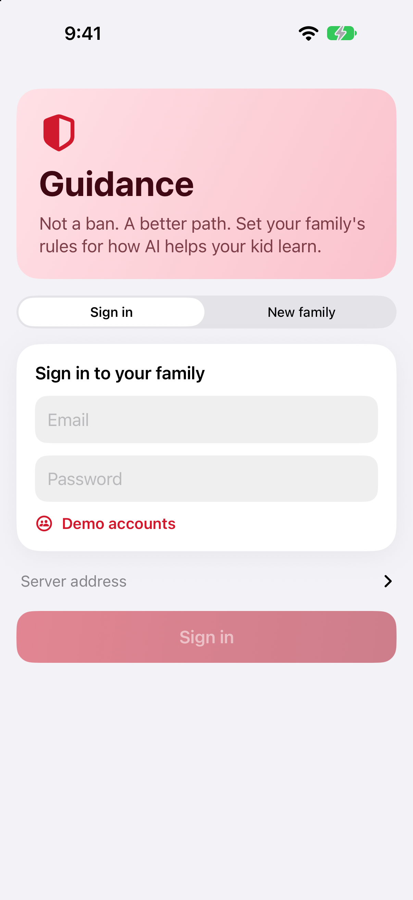 | **New family** — your name and your first kid 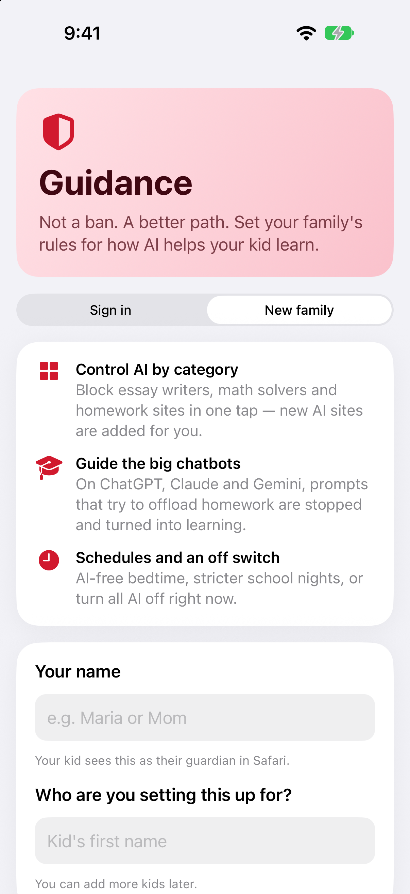 |
| **Lock screen** — what a kid sees if they open the app 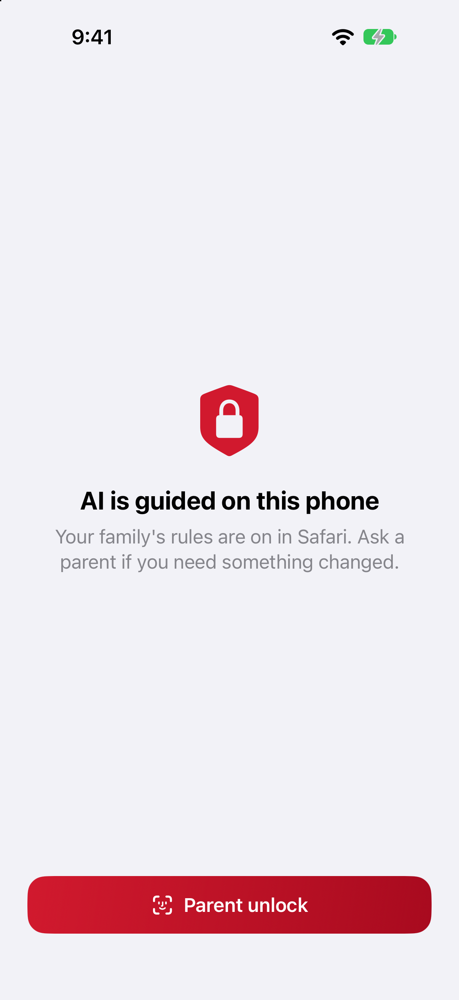 | **Rules** — kid selector (All kids / each kid), AI-off switch, categories 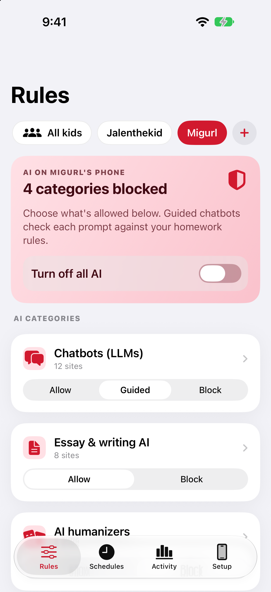 |
| **Category detail** — setting plus per-site exceptions 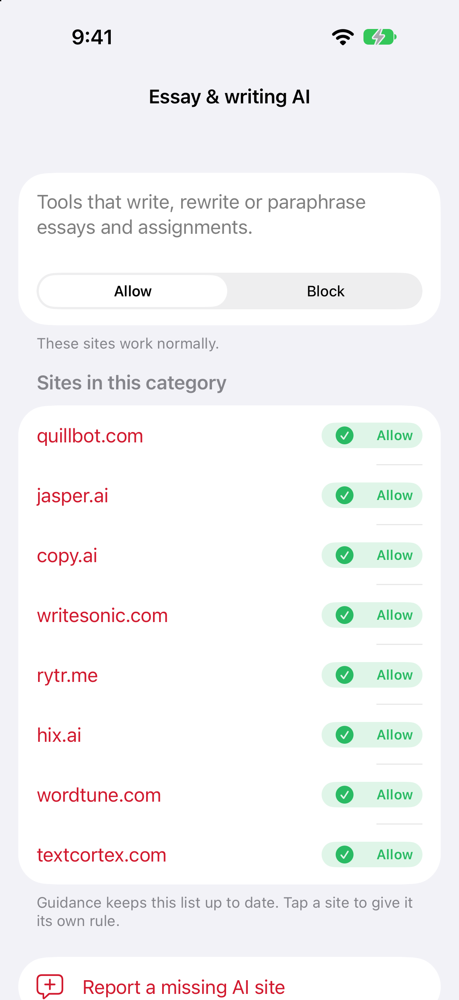 | **Homework rules** — offloading check, hide finished answers, instructions 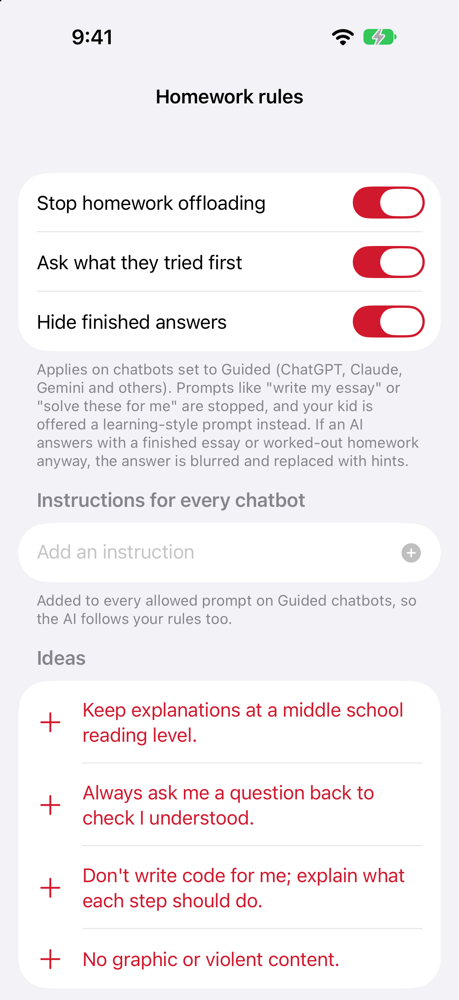 |
| **Safety alerts** — the 8 always-on topics 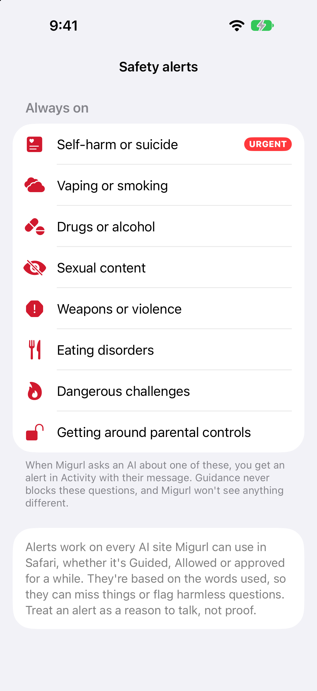 | **Site exceptions** — always allow / always block one site 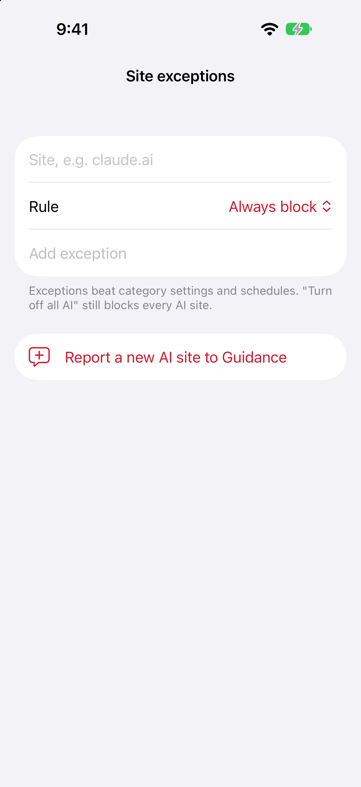 |
| **Schedules** — school nights, bedtime, custom 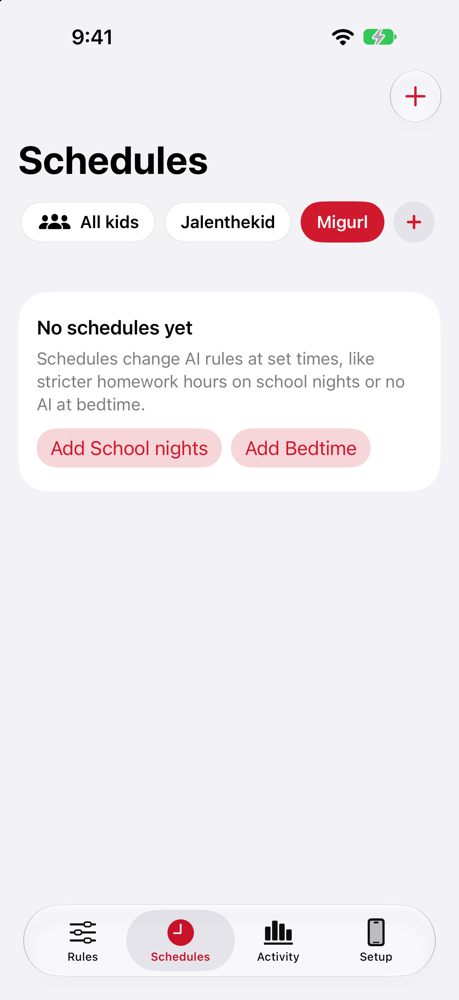 | **Schedule editor** — days, times, what changes 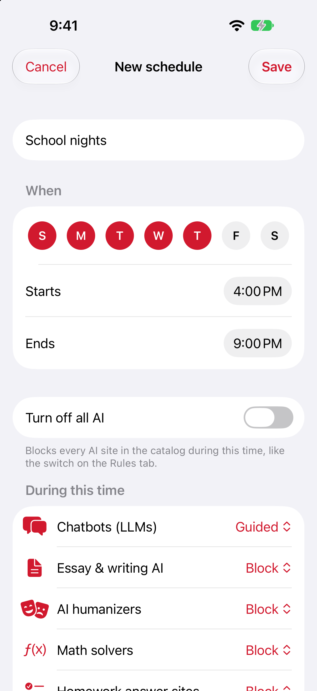 |
| **Activity** — requests, safety alerts, protection status, history 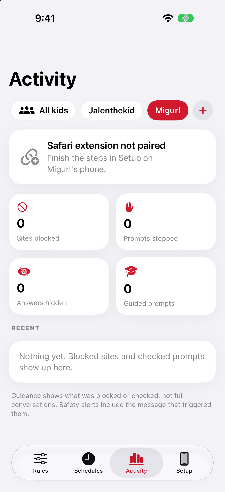 | **Setup** — kids, phone setup steps, your name, server 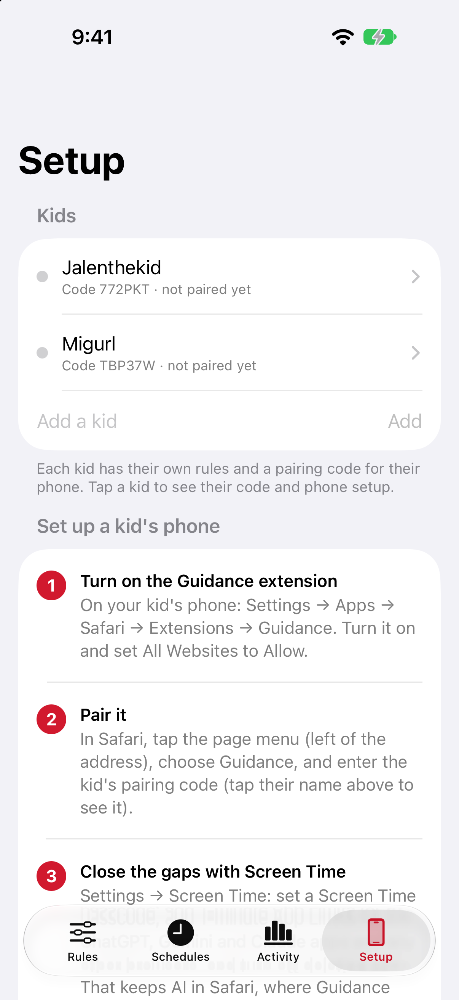 |
| **Kid profile** — name, pairing code, phone setup steps 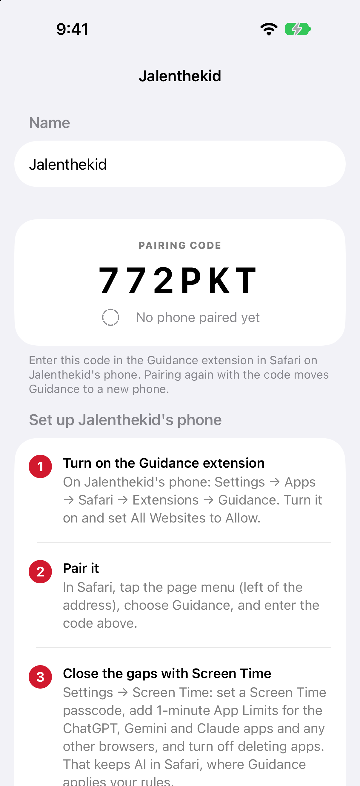 | |

## Kid's phone (Safari)

| | |
|---|---|
| **Blocked page** — reason, Ask for permission, Go back 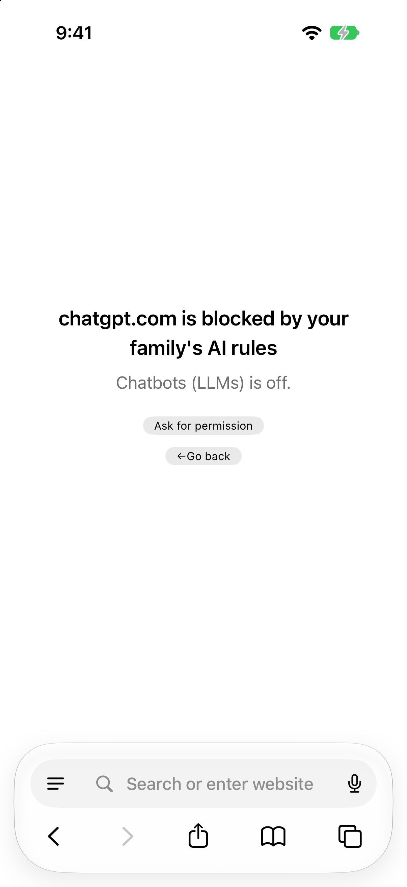 | **Extension popup** — not captured: iOS won't open the popup from outside Safari, and it needs a tap on the page menu. It shows "Guardian: <name>" with a status dot, Last update, and Pair with a different code. |

Not shown: the "Try it yourself first" and hidden-answer panels on chatbots (they need a live chatbot conversation) and the Ask-for-permission form (needs a tap).
